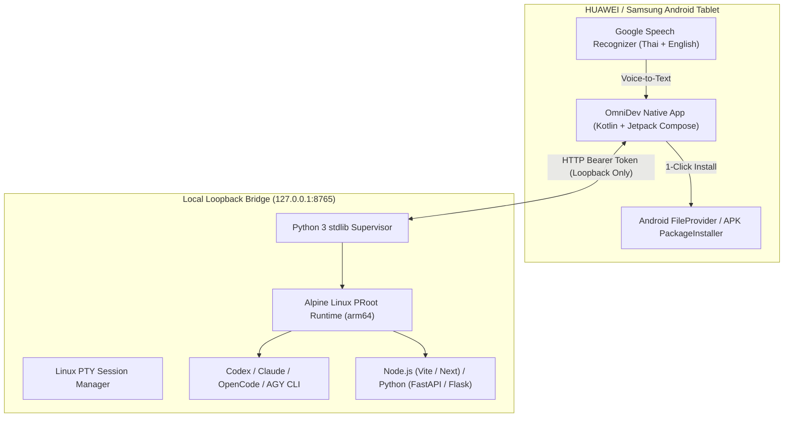

# 📖 OmniDev Tablet — Official User & Developer Guide

> **OmniDev Tablet (v0.1.0 Full Release)**
> A prompt-first native Android agentic software development studio designed specifically for Android tablets. Develop Frontend, Backend, Full Stack web apps, and build native Android APKs completely on your tablet without requiring a remote PC or desktop IDE.

---

## 📑 Table of Contents

1. [Architecture & Philosophy](#1-architecture--philosophy)
2. [Quick Start & Setup](#2-quick-start--setup)
3. [Prompt-First Agent Studio (Aion Orchestrator)](#3-prompt-first-agent-studio-aion-orchestrator)
4. [Multimodal 25 MB Attachments & Voice Input](#4-multimodal-25-mb-attachments--voice-input)
5. [Full Stack Workflow & Live Preview Logs](#5-full-stack-workflow--live-preview-logs)
6. [In-Chat Syntax Highlighting & 1-Tap Apply to File](#6-in-chat-syntax-highlighting--1-tap-apply-to-file)
7. [In-App PRoot Linux PTY Terminal](#7-in-app-proot-linux-pty-terminal)
8. [Git Branch Manager & Safe GitHub Push](#8-git-branch-manager--safe-github-push)
9. [Android APK Builder & 1-Click System Installer](#9-android-apk-builder--1-click-system-installer)
10. [Hermes Episodic Memory Ledger](#10-hermes-episodic-memory-ledger)
11. [Video Walkthrough Outline & Script](#11-video-walkthrough-outline--script)

---

## 1. Architecture & Philosophy

- **Prompt-First:** No full desktop IDE required. You describe features, review plans/diffs, inspect live previews, and iterate.
- **100% Local-First:** Project files, Git repos, packages, and dev servers run inside the tablet's local storage and Alpine PRoot environment.
- **Zero Insecure Cloud Runtimes:** No remote VPS or open tunnel needed for development.

---

## 2. Quick Start & Setup

1. **Install OmniDev Tablet:**
   - Download `app-debug.apk` or `app-release.apk` from GitHub Releases.
   - Tap to install. Grant the `RECORD_AUDIO` permission (for Voice Input) and notification permission (for foreground agent services).
2. **First Launch (Zero Configuration):**
   - On first launch, OmniDev automatically unpacks its embedded Alpine PRoot Linux runtime and generates an encrypted local device token (`SecureDeviceToken`).
3. **Configure Providers (Settings -> Providers):**
   - OpenAI API key or ChatGPT Codex CLI OAuth.
   - Anthropic API key or Claude Code OAuth.
   - Google Gemini API key or Antigravity (AGY) token.
   - GitHub Personal Access Token (for cloning private repos and pushing commits).

---

## 3. Prompt-First Agent Studio (Aion Orchestrator)

The main chat interface is powered by the **Aion Multi-Agent Orchestrator**:

- **Switch Agents Mid-Conversation:** Start a task with Codex, switch to Claude for a complex refactor, and ask AGY for documentation — all inside a single continuous chat thread.
- **Context Synthesis:** When switching agents, OmniDev synthesizes the previous turns into a unified context summary so the new agent understands the existing history.
- **Auto Quota Failover:** If Codex hits an OpenAI rate limit or token quota, Aion automatically fails over to Claude or AGY to complete the task seamlessly.

---

## 4. Multimodal 25 MB Attachments & Voice Input

### 📎 Quick Attachment Sheet
Tap the `[📎]` paperclip button next to the prompt bar to open the 4-category sheet:
1. **📷 Photos & Images:** Pick mockups, UI screenshots, or design bug photos.
2. **🎥 Video Clips:** Attach screen recordings of UI glitches.
3. **📄 Documents:** Attach PDF specs, requirements documents, or CSV data.
4. **📁 Project Workspace Files:** 1-tap attachment chips for quick project files like `package.json`, `README.md`, or source files.

All attachments are automatically validated (up to **25 MB**), Base64 streamed into `.agents/attachments/<file>`, and injected into the prompt so agents can use their multimodal vision capabilities.

### 🎤 Voice Input (Thai & English)
Tap the `[🎤]` microphone button:
- Uses Google Speech Recognition with automatic language detection (`th-TH` and `en-US`).
- Directly transcribes speech into the prompt composer without needing an on-screen keyboard.

---

## 5. Full Stack Workflow & Live Preview Logs

OmniDev Tablet supports full stack development:

| Stack | Dev Server Detection | Verification Script |
|---|---|---|
| **Next.js / Vite / React** | `package.json` (`scripts.dev`) | `npm run build` or `npm test` |
| **Monorepo** | `frontend/package.json` + `backend/` | `npm --prefix frontend run build` |
| **Python FastAPI** | `main.py` / `app.py` (`uvicorn`) | `pytest -q` or `python -m unittest` |
| **Python Flask** | `app.py` (`flask run`) | `pytest` |
| **Static Web** | `index.html` (built-in HTTP server) | Static asset verification |

### 🔍 Live Preview Logs Drawer
Inside the **Preview** tab or **Split View (Chat + Preview)**:
- Expand the **Server Logs** panel to view live stdout/stderr logs from your Vite or FastAPI server in real time.
- All secrets (API keys, tokens) are automatically redacted in log outputs.

---

## 6. In-Chat Syntax Highlighting & 1-Tap Apply to File

Assistant responses now render with enhanced GitHub Flavored Markdown:
- **Headings & Badges:** Clean visual hierarchy for tablet screens.
- **Alert Blocks:** `> [!NOTE]`, `> [!TIP]`, `> [!IMPORTANT]`, `> [!WARNING]`, and `> [!CAUTION]`.
- **Markdown Tables & Checklists:** Scrollable horizontal tables and interactive task checklists.
- **Syntax Highlighted Code Blocks:** Colorized syntax for JavaScript, TypeScript, Python, Kotlin, JSON, HTML/CSS, and Git Diffs.
- **Interactive Action Bar:**
  - `[Copy Code]` — copies the code snippet to the Android clipboard.
  - `[Apply to File]` — opens a confirmation dialog with auto-detected workspace path, creates an automated pre-apply Git checkpoint, and safely writes the file to your project!

---

## 7. In-App PRoot Linux PTY Terminal

Switch to the **Terminal** tab from the top navigation bar:
- **Real Linux PTY Session:** Spawns `/bin/sh` or `/bin/bash` directly inside your project folder within Alpine PRoot.
- **TUI Compatible:** Supports interactive terminal tools like `nano`, `vim`, `htop`, and Python interactive REPL.
- **Tablet Extra Keys Toolbar:**
  - `ESC`, `TAB`, `CTRL+C`, `CTRL+D`, `↑`, `↓`, `←`, `→`, `/`, `-`, `|`, `~`.
- **Quick Command Chips:** 1-tap chips for `git status`, `ls -la`, `npm test`, `pytest`, `pwd`, and `uname -a`.

---

## 8. Git Branch Manager & Safe GitHub Push

Tap the **Git** icon in the top bar to open the Git review dialog:
- **Branch Switcher:** View local branches and switch with 1 tap (`git checkout <branch>`).
- **Create Branch:** Create a new branch directly (`git checkout -b <new-branch>`).
- **Unified Diff & Rollback:** Review uncommitted line-by-line diffs with pre-repair checkpoints and instant rollback.
- **Safe Push to GitHub:**
  - Authenticates securely via `GITHUB_TOKEN` from encrypted device storage.
  - Never saves tokens to `.git/config`.
  - Forbids `--force` pushes to protect remote history.
  - Requires explicit confirmation of the destination branch before pushing.

---

## 9. Android APK Builder & 1-Click System Installer

When building an Android app (e.g., React Native, Flutter, or native Kotlin project):
- OmniDev automatically scans for compiled `.apk` files inside `build/outputs/apk/`.
- Surfaces an **"Install APK"** button directly in the chat header and project actions.
- Tapping **Install APK** securely streams the APK via Android `FileProvider` and launches the native Android Package Installer dialog to install and test your build in seconds!

---

## 10. Hermes Episodic Memory Ledger

OmniDev remembers lessons learned across sessions in `.agents/memory.md`:
- **Proven Patterns:** Framework patterns and configurations verified to pass tests.
- **Known Pitfalls:** Build errors, compiler warnings, and runtime exceptions.
- **Past Fixes:** How previous bugs were resolved.

Every prompt automatically injects Hermes memory context, preventing agents from repeating the same mistakes.

---

## 11. Video Walkthrough Outline & Script

| Chapter | Time | Content & Visuals |
|---|---|---|
| **01. Intro** | 0:00 - 0:45 | Show OmniDev Tablet running on HUAWEI MatePad. Explain the prompt-first, local-first vision. |
| **02. Setup** | 0:45 - 1:30 | Quick tour of embedded Alpine PRoot runtime, Settings, and API Key configuration. |
| **03. Multimodal & Voice** | 1:30 - 2:30 | Attach a UI mockup screenshot via Quick Attachment Sheet (25MB). Use Thai voice input: *"สร้างหน้า Login สไตล์มินิมอลตามรูปที่แนบ"*. |
| **04. Live Preview** | 2:30 - 3:45 | Show Split View with live Vite preview. Open Server Logs drawer to inspect real-time outputs. |
| **05. Code Apply & PTY** | 3:45 - 5:00 | Inspect syntax-highlighted code in chat, tap `[Apply to File]`. Switch to Terminal tab and run `npm test` using extra keys. |
| **06. Git Push & APK Install** | 5:00 - 6:00 | Create a feature branch, push to GitHub, and trigger 1-Click APK Install. Wrap-up. |
